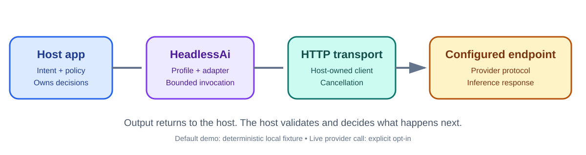

# ✳️ 00 TheSingularityWorkshop.HeadlessAi.AnyAppExample

[](https://github.com/TrentBest/TheSingularityWorkshop.HeadlessAi.AnyAppExample/actions/workflows/build.yml)
[](LICENSE)

<p align="center"></p>
<p align="center"><em>A runnable host application, a controlled endpoint, and no hidden agent magic.</em></p>

## 🟦 01 The problem—and our response

A library becomes easier to trust when a developer can see it used in a real application-shaped program. This repository is the **hands-on companion** to [HeadlessAi](https://github.com/TrentBest/TheSingularityWorkshop.HeadlessAi): a small .NET console host showing how to configure a profile, create an adapter-backed agent, send input, handle output, and keep application authority outside the library.

The example runs deterministically against a local fake HTTP handler by default. An optional live mode can call the OpenAI Responses endpoint when you explicitly configure credentials and opt in.

## 🟣 02 The Workshop documentation map

This repository follows the [FSM_COS documentation standard](https://github.com/TrentBest/TheSingularityWorkshop.FSM_COS/blob/development/DOCUMENTATION_STANDARD.md): **edify, not mystify**. It focuses on integration rather than repeating HeadlessAi's full theory.

- [Run the example](docs/usage.md) — build and execute it safely.
- [Architecture and boundaries](docs/architecture.md) — what the host owns and what HeadlessAi owns.
- [Live endpoint setup](docs/live-mode.md) — explicit opt-in, environment variables, and credential handling.
- [Testing](docs/testing.md) — what the deterministic test suite proves.
- [Documentation index](DOCUMENTATION_INDEX.md) — the guided reading path.
- [HeadlessAi documentation](https://github.com/TrentBest/TheSingularityWorkshop.HeadlessAi) — authoritative library concepts and API behavior.

## 🩵 03 The problem and solution in depth

The example uses the same sequence a real host would use:

1. Define an endpoint profile with endpoint-specific settings.
2. Select an adapter that understands the endpoint's protocol.
3. Inject an `HttpClient` owned by the host.
4. Send a normalized `HeadlessAiInput`.
5. Inspect the normalized `HeadlessAiOutput`.
6. Decide in the host what the output means and whether anything should happen next.

The default fake handler returns a known response without network access, secrets, provider charges, or nondeterministic model output. Live mode is separate and requires an explicit environment-variable opt-in.

## 🟢 04 See it in a minute

Prerequisite: .NET 8 SDK. From the repository root:

```bash
dotnet restore TheSingularityWorkshop.HeadlessAi.AnyAppExample.slnx
dotnet run --project src/TheSingularityWorkshop.HeadlessAi.AnyAppExample
```

Expected default output includes `Hello from the local HeadlessAi demonstration.` No API key or live network call is required for the default run.

To use the live endpoint, follow [Live mode](docs/live-mode.md) first. Never commit a key or place it in a checked-in settings file.

## 🟪 05 Documentation and theory

| Guide | What you will learn |
|---|---|
| [Usage](docs/usage.md) | How to build and run the demo |
| [Architecture](docs/architecture.md) | Where the host ends and the library begins |
| [Live mode](docs/live-mode.md) | How to opt into an actual provider call |
| [Testing](docs/testing.md) | Which behavior is verified and how |
| [Roadmap](docs/roadmap.md) | What would make the example more useful next |

## Design rules

- The example does not execute model output as code or commands.
- The default path uses a fake HTTP handler and makes no external requests.
- The live path is opt-in and reads credentials from the process environment.
- The host owns cancellation, UI, memory, authorization, semantic validation, and any consequential action.
- The example is educational, not a production secret store or complete application security design.
- Package publishing is not part of this repository's build workflow.

---

<p align="center"><em>The Singularity Workshop — Tools for the curious, the bold, and the systemically inclined.</em><br><strong>Because state shouldn't be a mess.</strong></p>
