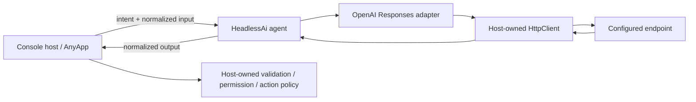

# Architecture and responsibility boundaries

The demo deliberately keeps application authority outside HeadlessAi.

## Host owns

- User experience, input collection, and task intent.
- Credential sourcing and the decision to enable live mode.
- Cancellation, application-level concurrency, budgets, and retry policy.
- Validation of model output and authorization of any resulting action.
- Memory, tool execution, and persistence.

## HeadlessAi owns

- Endpoint invocation and the selected adapter's protocol mapping.
- Request cancellation and profile timeout behavior.
- Bounded response handling and normalized output extraction.

## Provider owns

- The actual endpoint protocol, model availability, authentication rules, billing, quotas, and inference.

The default fake handler makes the flow testable. It is not a simulation of model quality or provider latency. Live mode changes only the transport and credentials; it does not give returned text permission to execute.
